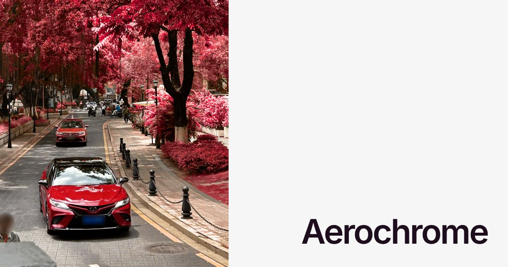

# Aerochrome



Infrared-style colour looks for photos, entirely in the browser. Nothing is uploaded.

## How it works

Phone cameras don't record infrared, so the looks are colour transforms rather than a real
channel swap. Each preset is a function in OKLCh (`src/lib/color/looks.ts`) that:

- finds vegetation by hue and chroma and rotates it (red, magenta, orange…), with optional lift;
- deepens blue skies, nudges teal/cyan;
- keeps skin and existing reds mostly intact (the "Film" preset instead does the
  film-accurate NIR→R, R→G, G→B shift on an estimated NIR channel);
- tints neutrals and applies a tone curve.

The function is baked into a 33³ float 3D LUT and applied in a WebGL2 shader together with
sharpening and "Filmness" (grain, halation, vignette, softness, fade). Effects are defined
relative to the full image, so the preview matches the export.

Colour is processed in Display P3 where the browser supports it (Chrome, Safari), and exports
embed a P3 ICC profile. Export renders full resolution in tiles and encodes JPEG (q96, 4:4:4)
with MozJPEG in a worker. Copy puts a PNG (max 4096 px) on the clipboard.

## Using it

- **Tweak** (0–100) gives each preset reproducible variations; 50 is the preset as designed.
  The value is remembered per preset for the browser session (thumbnails show it) and resets to
  50 for presets you haven't tweaked. Neighbouring values look alike, so scrubbing morphs smoothly.
- Click or tap the photo for a fullscreen view: drag to pan; pinch, scroll or double-tap to zoom.
  Zoomed views render from the full-resolution original.
- On phones, swipe the photo left/right to change preset and drag the handle down to hide the
  presets pane.

| Key | Action |
|---|---|
| ← / → | Previous / next preset |
| ↑ / ↓ | Same preset in the previous / next group |
| T, Shift+T | Random Tweak, reset Tweak |
| F | Fullscreen (Esc closes) |
| \\ (hold) | Show the original |
| O, ⌘/Ctrl+O | Open a photo |
| ⌘/Ctrl+V | Paste a photo |
| ⌘/Ctrl+C | Copy (PNG, max 4096 px) |
| ⌘/Ctrl+E or S | Export JPEG |
| + / − / 0 / 1 | Fullscreen: zoom in / out / fit / 100% |

## Develop

```bash
npm install
npm run dev
```

```bash
npm run check   # svelte-check
npm run build   # static build in dist/, deployable to Vercel as is
```

## Limits

- Files over 80 MB are refused. Export is capped at ~50 MP on phones and ~120 MP elsewhere,
  and downscaled beyond that with a notice.
- HEIC opens only where the browser can decode it (Safari).
- EXIF metadata is not carried over to exports.
